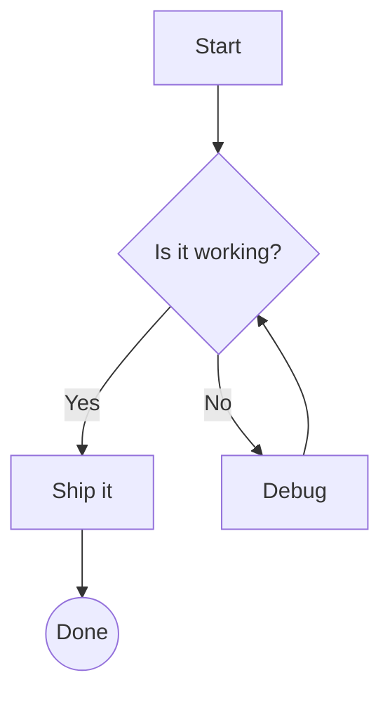
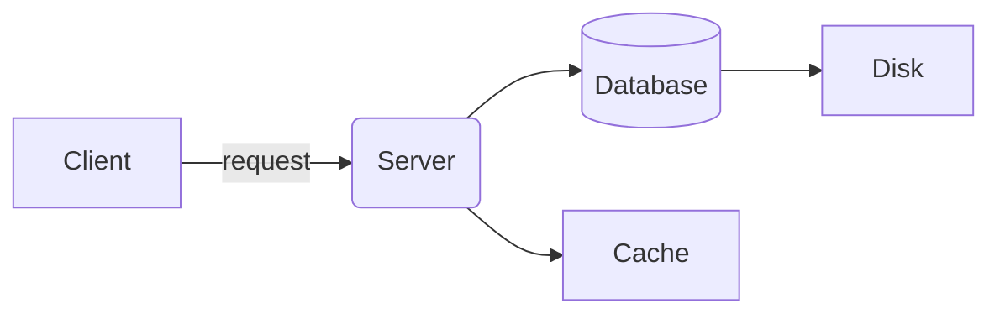
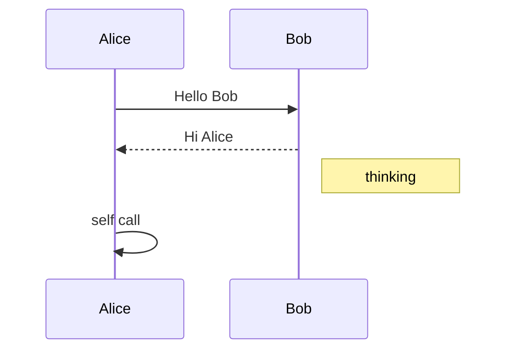
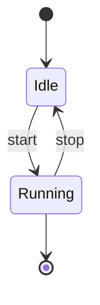
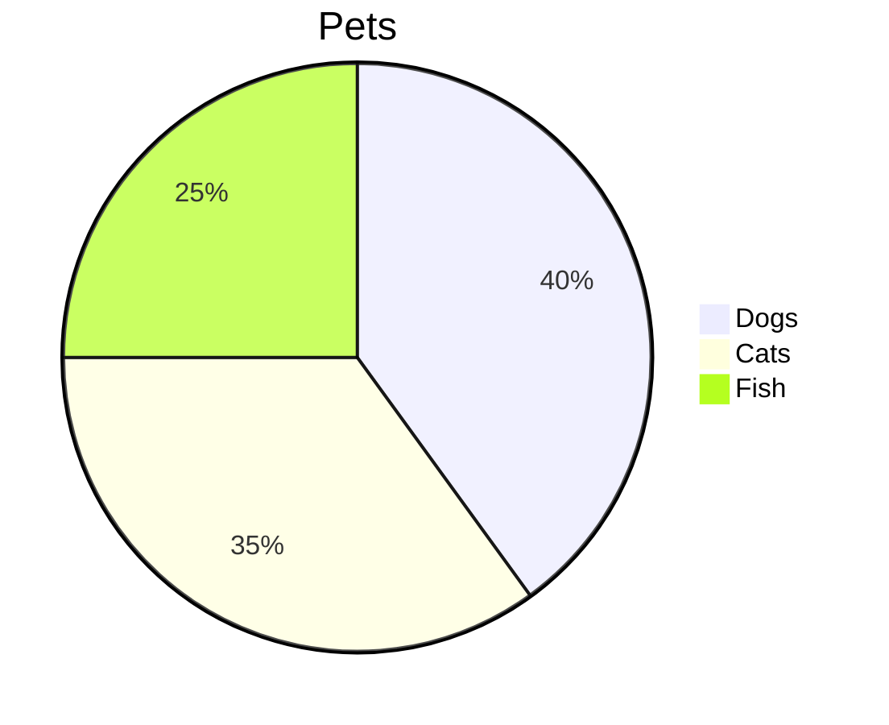
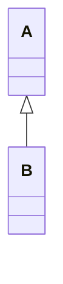

# mdcat demo

Some **bold**, *italic*, ~~strike~~, `inline code` and a [link](https://example.com). A very long line of text that should wrap nicely at the terminal width so we can verify the word wrapper handles things properly.

## Lists

- one
- two
  - nested a
  - nested b
- [x] done task
- [ ] open task

1. first
2. second

> A quote with **bold** text
> > nested quote

| Name | Qty | Notes |
|:-----|----:|:-----:|
| apple | 3 | fresh |
| banana | 12 | ripe and yellow |

---

```python
print("hi")
```












